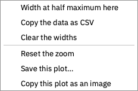

# Reading the results

The Analyse stage is a rail of pages down the left and one page shown at a time. Every
page is at the same position along z, chosen with the **z** slider at the foot of the
window, and each page's controls sit beside it on the right. A run's own pages depend on
its class ([the problem classes](classes.md)); a page that a results file cannot support
is shown greyed out, with the reason as its tooltip.

The pages read the results file through {py:mod}`solprop.processing`, the same functions
a script uses ([reading results](../results/processing.md)), so a number on a page is
the one a script gets. Opening a results file from Home brings back its setup too, from
the recipe the file records.

## Moving through a run

- **The z slider** sets the plane every page shows. Clicking a map whose axis is z, or
  dragging along it, moves the plane to that point.
- **Left and right arrow keys** step a plane; **up and down** step a page.
- While a run goes, *Follow the newest plane* keeps the slider on the plane last saved.

## The pages

These are the guided classes' pages; the free-space ones are in
[the problem classes](classes.md#free-space-beams).

**Overview** shows the spectrum and the pulse along z as maps, and both at the plane as
lines. The spectral axis is wavelength or frequency, the spectra are in decibels down
to a **floor** you set, and **Time range** sets how much of the window the pulse map
shows.

**At this plane** gives the plane's energy and duration, then its spectrum, its pulse
and its spectral phase. Type a **band** or drag one on the spectrum: the page then gives
the energy in the band, and draws the pulse filtered to it beside the whole pulse.
**Whole spectrum** clears the band. With several modes, choose one mode or their sum.

**Spectrogram** is the plane's spectrogram, gated by a pulse whose width you set
(solprop's {py:func}`~solprop.processing.fields.get_spectrogram`).

**Along z** plots what solprop recorded at every step, up to four quantities at once:
energy, peak power and intensity, electron density and the others the run's
[statistics](../results/statistics.md) hold. **Log axes** is *Auto* by default, which
puts a quantity that spans decades on a logarithmic axis.

**Modes**, for a run of several modes, gives the energy in each mode along z and each
mode's spectrum at the plane.

**Compress** sends the plane through a chain of optical elements (chirped mirrors, a
prism pair, a grating pair, a length of glass or gas, or a Taylor phase) and draws the
pulse before,
after and at its transform limit ([compression](../workflows/compression.md)). An
element set to *Auto* is searched by solprop for the shortest pulse; **Take the values
found** fixes them. The plane and band compressed are the ones chosen on *At this plane*.

**Run health** says how the run went: its step size along z with the rejected steps,
the light removed at the time window's edges, the run's record (its backend and
threads, its wall time and peak memory) and its log. Check it before trusting a result: a run whose light
reaches the window's edges, or whose steps collapse, needs a wider window or a smaller
tolerance ([numerics](../numerics/index.md)).

## The plot tools

Every plot in the window works the same way.

- **Hover** over a plot to read it: on a line plot, the nearest curve's value under the
  pointer; on a map, the position and the value there.
- **Zoom** with the wheel over the plot, or over one axis to zoom that axis alone.
  **Drag** to pan. A **double click** goes back to the page's own view. A zoomed plot
  keeps its view while the plane changes or a run redraws it.
- **Right-click** for what can be done at that point:

  

  - *Width at half maximum here* measures the width of the nearest curve's peak at half
    its height (3 dB down on a decibel axis), and draws it on the curve with its value;
    *Clear the widths* takes the measurements away.
  - *Copy the data as CSV* puts the plot's curves on the clipboard.
  - *Go to the peak*, on a map along z, moves the plane to where the map is highest.
  - *Reset the zoom*, *Save this plot…* (PNG, or SVG) and *Copy this plot as an image*.

Pulses are drawn four times finer than the run's own time samples, by zero-padding
their spectrum as {py:func}`~solprop.processing.fields.get_power` does with
`oversampling=4`: this adds no information, but draws a short pulse smoothly and finds
its peak between the samples.

## Exporting

Each page's **Export** menu has:

- **Publication figure…**, the page drawn by {py:mod}`solprop.plotting` with Matplotlib,
  as PDF, SVG or PNG. Maps in it are embedded as images, so a vector figure stays
  small. It is offered where solprop draws the page; a free-space run's pages have none
  yet.
- **This page as an image…**, the page as it is on screen.
- **Data as CSV…**, the page's lines, where it has them.
- **Copy as Python**, the code that draws the page from the results file with
  {py:mod}`solprop.processing` and {py:mod}`solprop.plotting`, to carry on in a script.
