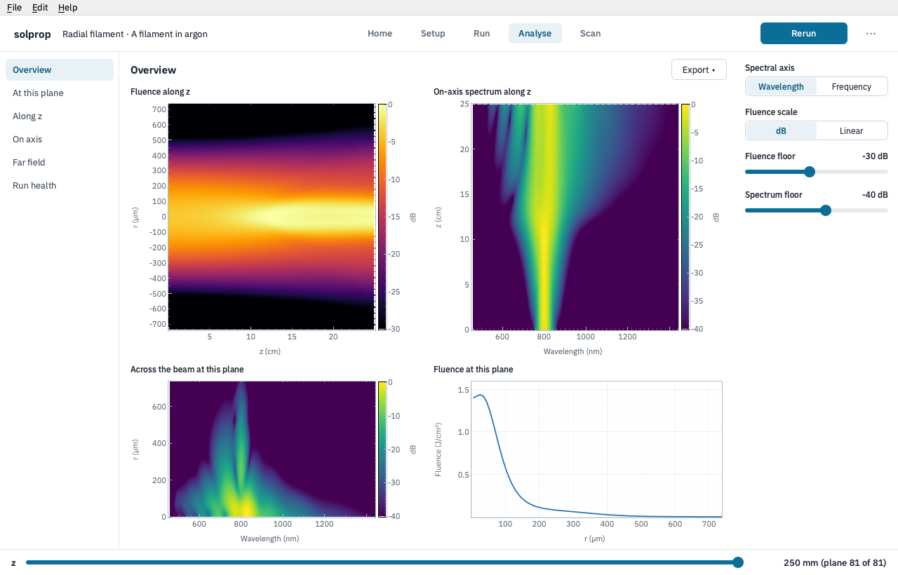

# The problem classes

Each tile on Home is a **problem class**: a geometry the window sets up with its own
sheet, computes its own numbers for, and reads with its own pages. A class starts from
one of solprop's [example recipes](../setup/recipes.md#the-example-recipes), and
**Start from** on its sheet offers a few more chosen for it; solprop's other examples
belong to the gallery's scripts. Whatever a class does not
show on its sheet is under **Advanced**, so no keyword of the route is out of reach.

Every class shares the stages, the z slider and the plot tools; what differs is listed
here. The pages themselves are described in [Reading the results](analysis.md).

## Gas-filled hollow guides

**Capillary** is a gas-filled hollow [capillary](../waveguides/capillaries.md),
mode-averaged or with several modes (the *Modes* row; a multimode run adds the *Modes* page). Its numbers come from
{py:func}`solprop.tools.capillary_params`: the soliton order, the zero-dispersion
wavelength and the dispersive wave, each of which can be set as a target, and the peak
power and intensity, the fission length and the loss at the pump. Its preview is the
group-velocity dispersion at the entrance. Its pages are *Overview*, *At this plane*,
*Spectrogram*, *Along z*, *Modes*, *Compress* and *Run health*.

**Antiresonant fibre** is a gas-filled [hollow fibre](../waveguides/antiresonant.md)
with a lattice of tubes, set by
their number, radius and wall thickness. Its numbers are the capillary's, from the
fibre's own mode, and only the soliton order can be set as a target. Below the
dispersion it draws the loss against wavelength and the fibre's cross-section to scale.
Its pages are the capillary's.

The gas row offers solprop's gases by name, and the pressure can be a single value or a
profile along the guide (*from … to*): [gas profiles](../waveguides/profiles.md).

## Free-space beams

**Radial filament** is a beam in [free space](../free-space/index.md) on a radial
grid: self-focusing, plasma and filamentation in a gas. The beam is given by its waist and the distance **to
focus**; *From a lens…* sets both from a lens's focal length and the beam on it. Its
numbers are P / P_cr with the critical power, the peak power, the Rayleigh range and
Marburger's collapse distance. Its preview is the beam's linear radius along z, with
the focus and the collapse marked. Its pages are an *Overview* of the fluence along z
(mirrored about the axis), the on-axis spectrum along z, the radius against wavelength
at the plane and the fluence across it; *At this plane* (the beam in r and time, and in
r and wavelength); *Along z*; *On axis* (the pulse, its spectrum and its spectrogram on
the beam's axis); *Far field* (angle against wavelength, where conical emission shows);
and *Run health*.

**Cartesian beams** starts from two beams crossing at 10 mrad in argon, on an x–y grid:
they interfere where they overlap, and the Kerr effect focuses the fringes. Each beam has
its own energy, waist, offset and angle in x, and they share a wavelength and duration;
the numbers (P / P_cr, critical power, peak power and Rayleigh range) are each beam's.
*Across the beam* maps the fluence over x and y at the plane. A recipe or file of one
beam on such a grid opens on a one-beam sheet with the filament's numbers.

**Line beam** is a beam resolved in x alone, per metre of y: its energy and peak power
are per metre, and *Across the beam* maps the fluence across x along z. It has no
collapse distance, so it shows no P / P_cr.

Free-space results files can be large, so the sheet's *Ready* line gives the output's
size before a run. Compression is not offered for free-space runs.

## Solid-core fibres

**GNLSE fibre** is a fibre given by its nonlinear coefficient γ and the Taylor
coefficients of its dispersion alone, in the generalised nonlinear Schrödinger equation
([the GNLSE](../waveguides/gnlse.md)). Its numbers are the soliton order, the
zero-dispersion wavelength, the energy, the dispersion, nonlinear and fission lengths,
and its preview the group-velocity dispersion. Its Raman row is solprop's GNLSE default,
the response of fused silica.

**Step-index fibre** is a solid core in a cladding of lower index
([step-index fibres](../waveguides/step-index.md)), its guided mode
solved by solprop for the GNLSE: the mode gives the dispersion, the loss and the
effective area, and γ comes from the mode and the nonlinear index n₂. An empty core row
is fused silica and an empty cladding row is air, index 1. It shows the mode's
dispersion and the fibre's cross-section.

**Graded-index fibre** is a core whose index falls from its axis, with several of its
modes coupled ([graded-index fibres](../waveguides/graded-index.md)). It is read from its index profile without solving it: its numerical
aperture, its V number and roughly how many modes a power-law core of that exponent
holds, with the index across the core as its preview. Its *Modes* page shows each
mode's spectrum, and gives no energy per mode: these modes are not orthogonal, so their
energies do not add, and the run records only their total (on *Along z*).

## Other routes

solprop has routes with no class in the window: the hollow rectangular guide, planar
guides and general modes among them. They are set up in scripts. A recipe or a results
file of such a route, opened from Home, still opens: on a form built from solprop's own
description of the route ({py:func}`solprop.recipe.metadata.parameters`), its sections
as solprop groups the keywords, with the energy and peak power of the launched pulse,
and with the pages its results file supports. The window finds a file's class from its
recipe, and uses this form when none fits.
