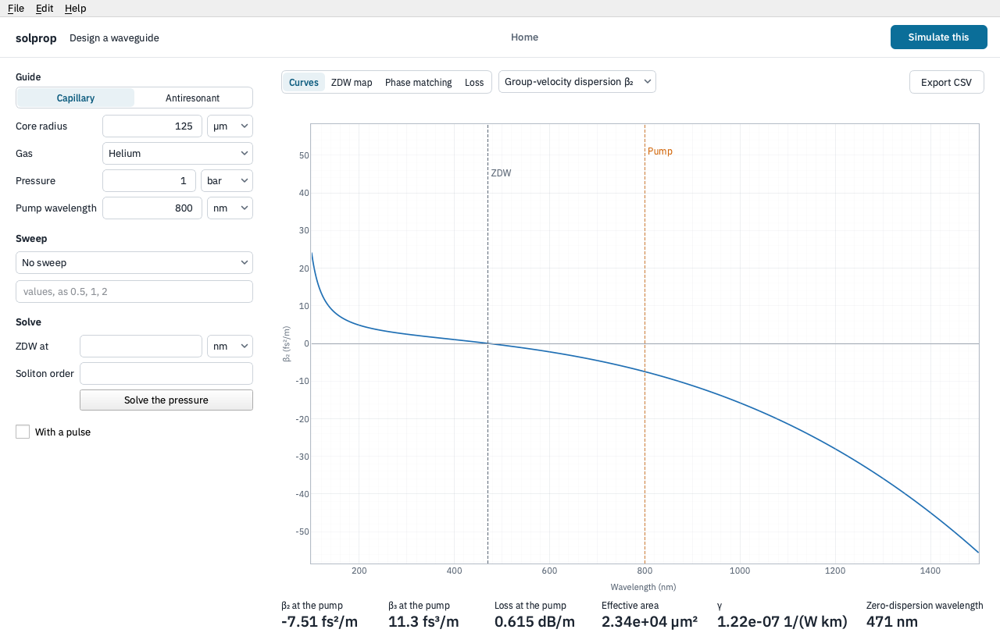

# Designing a waveguide

**Design a waveguide**, on Home, explores a gas-filled capillary or antiresonant fibre
before there is a pulse or a run: which pressure puts the zero-dispersion wavelength
where you want it, how the dispersion changes with the core, how much the fibre loses at
the pump. It never touches the setup you have open; **Simulate this** carries a design to
a new setup sheet when it is ready.

## The guide

Choose **Capillary** or **Antiresonant**, then the core radius, the gas, its pressure and
the pump wavelength (the antiresonant fibre adds its tubes). Every curve and number
follows as you type. The numbers below the plot are at the pump: β₂, β₃, the loss, the
effective area, γ and the zero-dispersion wavelength. They are the guide's
own, from solprop's mode ({py:mod}`solprop.modes`), with no pulse involved.

## The pages

- **Curves** plots one quantity against wavelength: the group-velocity dispersion β₂,
  the dispersion parameter D, the third-order dispersion β₃, the effective index or the
  group index. The pump and the zero-dispersion wavelength are marked.
- **ZDW map** draws, for each of several zero-dispersion wavelengths from 250 to 700 nm,
  the pressure that gives it against the core radius. Click a point to make that radius
  and pressure the design.
- **Phase matching** plots the phase mismatch Δβ against wavelength, whose zeros are the
  wavelengths a dispersive wave is emitted at: the linear mismatch, or with a pulse
  (below), the mismatch to a soliton at the pump, which adds its nonlinear phase.
- **Loss** plots the loss against wavelength.

**Export CSV** writes the plot's curves.

## Sweeps

**Sweep** draws a curve for each of several values of the pressure, the core radius or
the gas, so that you can compare them on one plot. Click a curve to adopt its value
into the design.

## Solving for a target

**Solve** finds the pressure that puts the zero-dispersion wavelength where you type it
(**ZDW at**), and with a pulse, the energy that gives a **soliton order** too; **Solve
the pressure** sets them. The solve is solprop's own, the same one a setup's
[targets](first-run.md#ask-for-a-number-instead-of-an-input) use.

## With a pulse

Tick **With a pulse** to give the pulse's duration and energy at the pump wavelength.
The numbers then add the soliton order, the peak power, the dispersion, nonlinear and
fission lengths and the dispersive wave's wavelength, and *Phase matching* includes the
soliton's nonlinear phase.

## Simulate this

**Simulate this** opens the design as a new, unsaved setup of the matching class, a
capillary or an antiresonant fibre, with the design's guide, gas and pulse written
in. If the setup you have open has unsaved changes, the
window asks first.
