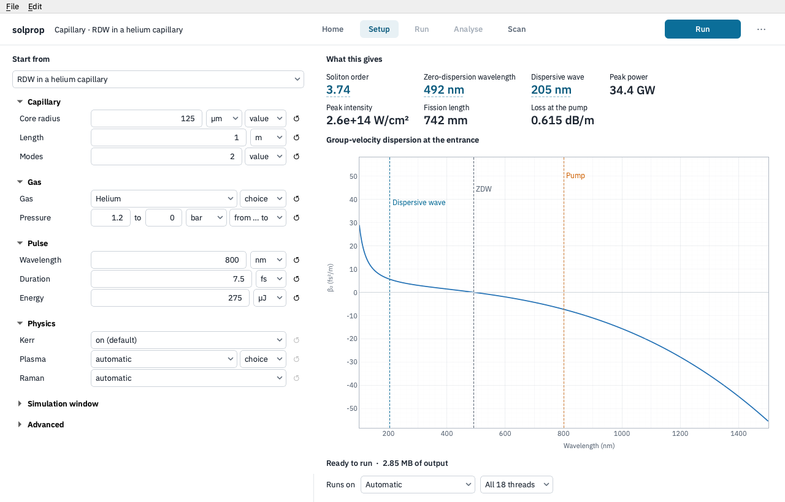
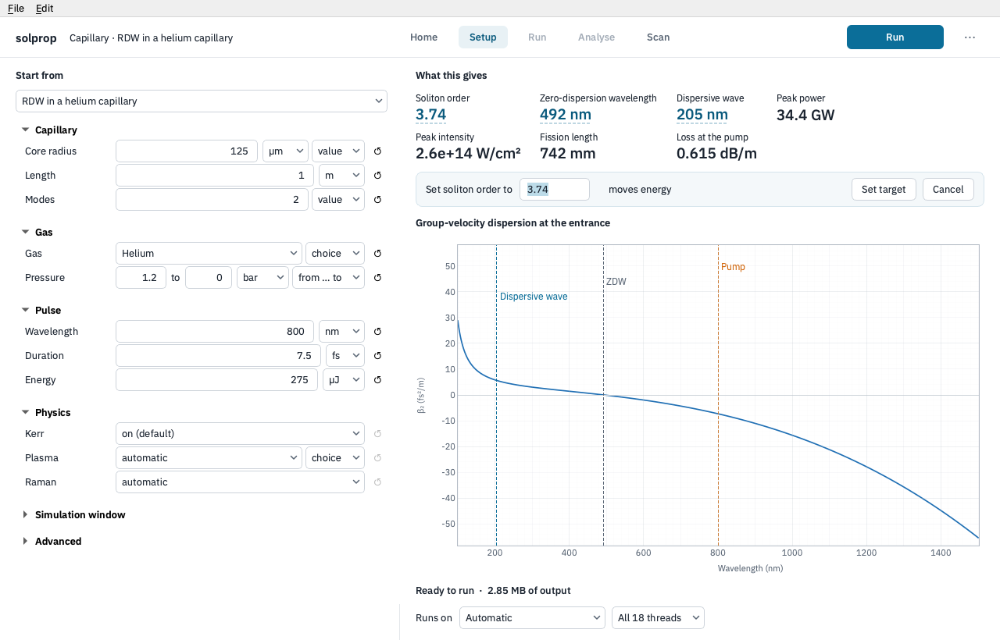
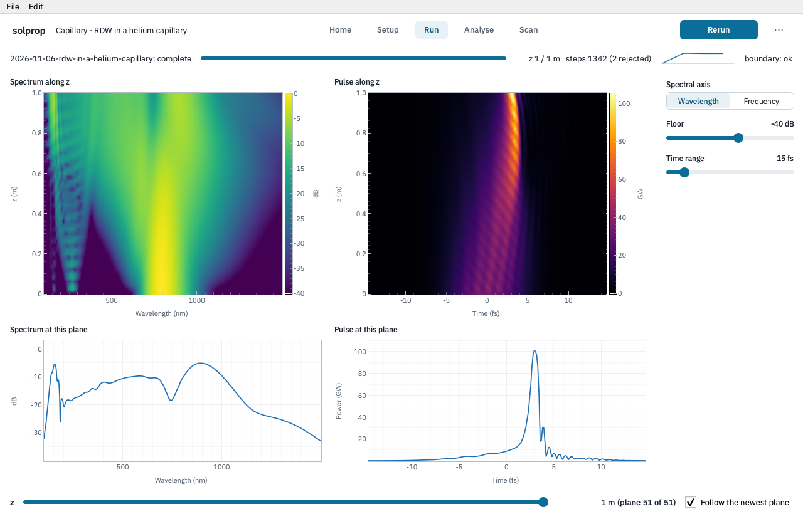
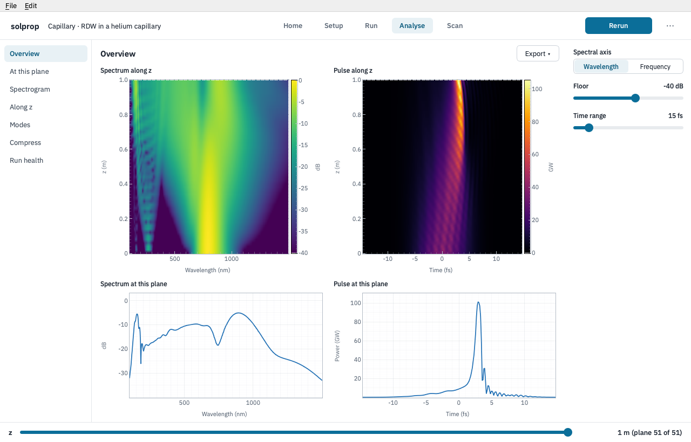
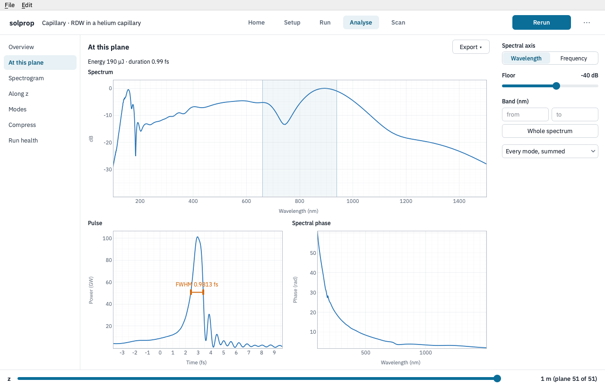

# A first simulation

This page follows one setup from Home to its results: a 7.5 fs pulse at 800 nm in a
helium-filled capillary, whose soliton self-compression emits a resonant dispersive wave
in the deep ultraviolet. It is solprop's `rdw` example recipe
(`Recipe.example("rdw")`); the introduction's first tutorial builds the same physics by
script.

## Choose what to simulate

Home asks *What are you simulating?* and offers one tile for each **problem class**, a
geometry the window knows how to set up and read ([the problem classes](classes.md)).
Click **Capillary**. The Setup stage opens on the capillary's sheet, filled in from
solprop's example for that class: every class opens ready to run.

**Start from** chooses another of solprop's examples of the same class. The parameters
are grouped as the physics groups them: the capillary, the gas, the pulse, the physics
switched on, and the simulation window (folded). Each row has the value, its unit, and
where the value can take another form, a choice of form: the pressure here is a
gradient *from* 1.2 bar *to* 0 bar along the capillary, the example's own profile. The
**↺** button puts a row back to the example's value. An empty row says what solprop
does when it is left empty. **Advanced** holds every other keyword of the route,
with a *Find any setting* box.

As you type, the right side follows:

- **What this gives** is computed by solprop from the setup as it stands
  ({py:func}`solprop.tools.capillary_params` for a capillary): the soliton order, the
  zero-dispersion wavelength, the wavelength of the dispersive wave, the peak power and
  intensity, the fission length and the loss at the pump.
- The plot is the **group-velocity dispersion at the entrance**, with the pump, the
  zero-dispersion wavelength and the dispersive wave marked.
- The line under the plot says whether solprop accepts the setup: *Ready to run*, with
  the size of the output it will write, or what is wrong, at the row that is wrong.
- **Runs on** chooses the backend and the number of threads. *Automatic* is solprop's
  own choice ([which backend](../performance/tuning.md#which-backend)); the threads
  default to the process's [thread budget](../performance/tuning.md#the-thread-budget).
  Choosing MLX, the Apple GPU backend, sets single precision, which is all MLX runs.

## Ask for a number instead of an input

The numbers drawn with a dotted underline can be set directly. Click **Soliton order**,
type the order you want, and choose **Set target**.

The editor says which input moves to give the number: here the energy, since the pulse
sets the order once the guide is fixed. The zero-dispersion wavelength and the
dispersive wave move the pressure or the core radius instead. The setup then holds the
target, not a solved number: the moved row reads *solved for soliton order …* and keeps
following as the other rows change, and **release** under it fixes the value it last
solved. Targets are solprop's [pins](../setup/recipes.md#pins), written to the
recipe's `[pins]` table, so a script that loads the setup solves them in the same way.

## Run it

Click **Run**. The Run stage shows the run as it goes: a strip with its progress, an
estimate of the time left, how far along z it is with its steps (and how many were
rejected), a line of the step size along z, and the state of the time window's edges.
The spectrum and the pulse grow along z beneath it, each plane drawn as solprop saves
it. **Stop** ends the run at its next step and keeps the planes it reached.

If the run fails, the stage says why and what to try. While a run goes, opening another
setup or results file asks first, since the window shows one run at a time.

## Read the results

When the run ends the window moves to **Analyse**, on its Overview page: the spectrum and
the pulse along z, and both at the plane chosen.

The **z** slider at the foot of the window is shared by every page: move it, or click a
map whose axis is z, and every page shows that plane. The left and right arrow keys step
through the planes, and up and down through the pages. The pages on the left are the
capillary's: *At this plane* (the spectrum with a band you can choose and its energy,
the pulse, and the spectral phase), *Spectrogram*, *Along z* (the statistics solprop
recorded), *Modes* (with several modes), *Compress* and *Run health*.
[Reading the results](analysis.md) describes each, with the tools every plot shares.

Here the pulse at the end of the capillary has compressed to about 1 fs. Right-click
the pulse and choose *Width at half maximum here* to measure it on the plot; the page's
own line above gives the same duration.

## Keep it, or carry on in a script

The run's folder already holds everything: `run.h5`, the recipe it ran and its log. Home
lists it under *Recent runs*, and opening it brings back both its results and its
setup. **⋯ → Save** keeps the setup as a recipe file of your own, and
**⋯ → Show as Python** shows the script that builds the same simulation. Each results
page's **Export** menu has *Copy as Python* too: the code that draws that page from the
results file, with {py:mod}`solprop.processing` and {py:mod}`solprop.plotting`.
