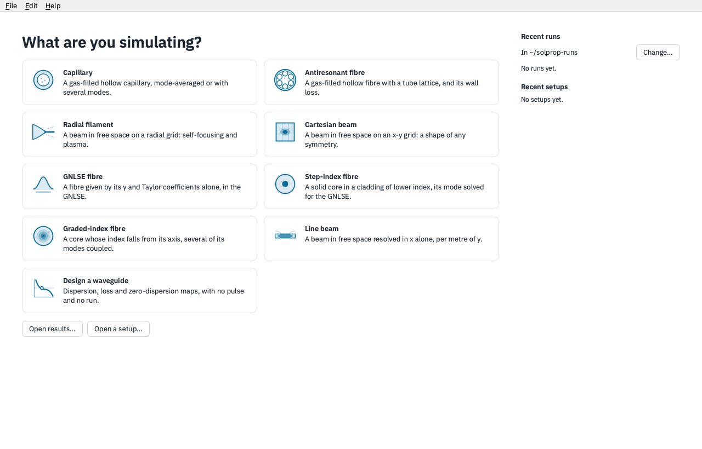

# The desktop front end

`solprop-gui` is a desktop window for setting up, running and reading solprop
simulations without writing a script. It is written for physicists who know the
experiment they want to model: a setup is described in physics terms (a capillary's
core radius, a gas and its pressure, a pulse's wavelength, duration and energy), and
solprop's own keyword names stay behind an **Advanced** section.

The window holds no physics of its own. Every number it shows, from a soliton order on
the setup sheet to a pulse's width on a results page, is computed by solprop; every
setup it writes is a solprop [recipe](../setup/recipes.md), which `solprop run` and
`Recipe.load` read in the same way; and every run is an ordinary solprop results file
that the [processing functions](../results/processing.md) read. What you build in the
window can be continued in a script, and a script's recipe can be opened in the window.



## Installing and starting it

The front end is an extra of solprop, installed with it:

```sh
uv pip install "solprop[gui]"
solprop-gui
```

or, with pip, `python -m pip install "solprop[gui]"`. It runs on the platforms of
[the installation page](../../introduction/installation.md), with the native backend
those wheels carry. From a checkout of the repository, add the extra to the
environment and start the window without syncing it again:

```sh
uv sync --extra gui
uv run --no-sync solprop-gui
```

`uv sync` builds the native backend from `native/` and needs a C++20 compiler; with no
compiler, follow the lightweight setup of
[contributing](../../dev/contributing.md) and install the wheel CI built with
`uv run --no-sync poe fetch-wheel`.

**On Linux** the window needs a few system libraries that Qt loads. On Debian or
Ubuntu:

```sh
sudo apt install libegl1 libxkbcommon0 libxcb-cursor0
```

The window is drawn with Qt (PySide6) and pyqtgraph. Its publication figures are
drawn with Matplotlib through {py:mod}`solprop.plotting`, so they match the figures a
script makes.

## The window

A bar across the top of the window names the **stage** you are on:

| stage | what it is for |
|---|---|
| **Home** | Choose what to simulate, design a waveguide, or open a setup or a results file |
| **Setup** | One sheet of the setup's parameters, with the numbers they give and a preview plot |
| **Run** | The run as it goes: its progress, and the spectrum and pulse growing along z |
| **Analyse** | Pages of the results, all at one position along z |
| **Scan** | A scan over one or more of the setup's parameters, and its results |

The button at the right of the bar does the stage's main thing: **Run** on a setup,
**Stop** while a run goes, **Rerun** afterwards, **Run scan** on the Scan stage and
**Simulate this** when designing a waveguide. The **⋯** menu beside it saves the setup,
shows it as a recipe, or shows it as the Python that builds it. **File** and **Edit**
hold the same with their usual shortcuts; every change to a setup is one step of
**Undo**. **Help → User guide** (F1 on Windows and Linux) opens this chapter in a window of
its own; it comes with the front end, so it reads offline. **Help → About solprop** gives
the versions running and the project's links.

A run goes into a folder of its own, `<date>-<title>`, holding its results file
`run.h5`, the recipe it ran (`recipe.toml`) and its log (`run.log`). The folders are made
in `~/solprop-runs` unless you choose another with **Change…** under *Recent runs* on
Home; the window remembers the choice. The folder is the record: Home lists what it
finds there, and copying a run's folder elsewhere loses nothing.

## In this chapter

- [A first simulation](first-run.md) follows one setup from Home to its results: a
  resonant dispersive wave in a helium-filled capillary.
- [The problem classes](classes.md) describes what each tile on Home sets up, and the
  numbers and pages it has.
- [Reading the results](analysis.md) covers the Analyse pages, the plot tools and
  exporting.
- [Scans](scans.md) runs a setup over a grid of its parameters.
- [Designing a waveguide](design.md) explores a guide's dispersion, loss and
  phase matching with no pulse and no run.

```{toctree}
:hidden:

first-run
classes
analysis
scans
design
```
