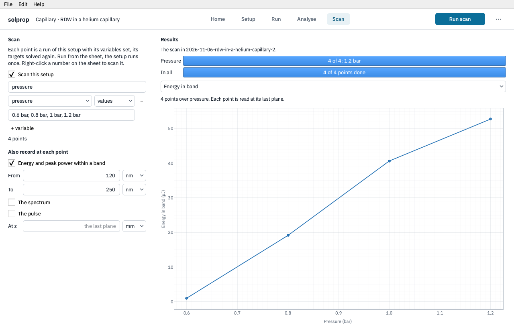

# Scans

A scan runs one setup at every point of a grid of its parameters: the capillary at
several pressures, say, or at every pair of a pressure and an energy. It is solprop's
own [scan](../workflows/scans.md), written to the setup's `[scan]` table and run with
{py:func}`~solprop.driver.scan.run_scan`, so a scan set up in the window runs the same
from `solprop run` or a script.

## Setting one up

Right-click a number on the setup sheet and choose **Scan this…**: the Scan stage opens
with that parameter as the scan's first variable, from its value. Or go to the **Scan**
stage and tick **Scan this setup**.

- The **name** names the scan's file and derives each point's random seed.
- Each **variable** is a parameter and its values, given as a list (`0.6 bar, 0.8 bar,
  1 bar`) or as a **range** of evenly or logarithmically spaced points. **+ variable**
  adds another; the scan runs every combination, and the stage says how many points
  that is.
- A pressure given as a profile along the guide offers each of its points as a
  variable of its own, so a scan can move the pressure at the entrance and leave the
  exit's.

At each point solprop records the run's statistics. **Also record at each point** adds
what the statistics do not hold: the **energy and peak power within a band** of
wavelengths, and on a scan of one variable, **the spectrum** or **the pulse**. Each is
read at the run's last plane, or at the distance **At z** gives. A point's own fields are
not kept, which keeps a scan small.

Every point is a run of the setup with its variables set, and with its
[targets](first-run.md#ask-for-a-number-instead-of-an-input) solved again: a scan of the
pressure under a soliton-order target moves the energy at each point to keep the order.

## Running it

**Run scan** runs every point. A bar for each variable, outermost first, shows the value
it is at, under one for the whole scan. **Stop** ends it within a step of the points
running; the points finished stay in its file. **Run** on the Setup stage runs the setup
once, without the scan.

## Its results

The scan's file goes in a run folder like any run, and opening it from Home brings it
back to this stage. Choose what to show from the list above the plot:

- A number, such as the energy in the band, is drawn against the first variable, with a
  line for each value of the second (up to eight). A point that failed is marked ×
  along the foot of the plot.
- A spectrum or a pulse recorded at each point is drawn as a map against the scan's
  variable.

Right-click a point and choose **Open this point as a setup** to open the setup at that
point's values as a new sheet, to run it with its fields kept or to change it further.
