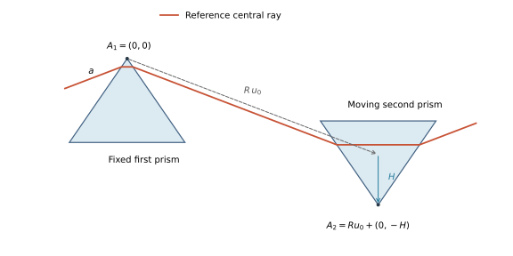

# Offline optics and compression

A propagation ends with a pulse that still has to get to an experiment: through a
window, down a beam line in air, off a set of chirped mirrors, through a pair of wedges.
{py:mod}`solprop.optics` describes those linear elements and
{py:mod}`solprop.processing.compression` searches their parameters for the shortest
pulse. Together they cover a Taylor-expanded spectral phase, a thickness of glass or
gas, chirped mirrors, grating pairs and prism pairs (the last two with explicit physical
tuning coordinates), the compressors that search each of them, and the optimisation of
the carrier-envelope phase. Everything here is applied to a saved plane after the run,
so no propagation is repeated; read this page to see a simulated pulse as it would
arrive at an experiment, or to design the compressor that gets it there. To send the
compressed pulse on into another simulation -- through focusing optics into a second
capillary, say -- apply the same elements to a field plane with
{py:class}`~solprop.coupling.elements.SpectralTransfer`
([coupling simulations](coupling.md#transporting-a-plane-between-planes)).

## One concept: a transfer function

Every element is a callable $H(\omega)$ giving the complex amplitude response **in the
optics convention** of [the conventions page](../../dev/conventions.md) §2:

$$
\tilde E_{\rm out}(\omega) = H(\omega)\,\tilde E_{\rm in}(\omega),\qquad
H = |H|\,e^{+i\varphi(\omega)} .
$$

The group delay is $+d\varphi/d\omega$, positive group-delay dispersion
$d^2\varphi/d\omega^2$ makes the blue arrive later, and a slab of normally dispersive
glass chirps positively: textbook signs. The processing layer applies an element to the
spectrum in the internal FFT convention (the arrays `output.fields("fft")` returns), so
there it multiplies by $e^{-i\varphi}$; that crossing is made in exactly one function,
{py:func}`~solprop.optics.stored_factor`, by {py:func}`solprop.fourier.to_internal`. A
transfer function is diagonal in frequency, so it commutes with the half-window origin
shift between the two conventions and the conjugation is all the crossing needs. The Taylor sum itself is written once,
{py:func}`~solprop.optics.taylor_phase`, and the pulse builders use the same one, so a
chirp put on a pulse with `phases=` is removed exactly by the opposite
{py:class}`~solprop.optics.TaylorPhase`.

Tests hold each element to the sign convention: positive GDD broadens a Gaussian to
$\tau\sqrt{1+(4\ln2\,\varphi_2/\tau^2)^2}$ and delays its blue half; a positive delay
coefficient arrives later; fused silica has $+36.16$ fs²/mm at 800 nm and a negative GDD
at 1550 nm.

### The elements

{py:class}`~solprop.optics.TaylorPhase` is $\varphi(\omega)=\sum_n c_n(\omega-\omega_0)^n/n!$
with the coefficients zero-based — `(CEP, delay, GDD, TOD, ...)` in rad, s, s², s³ — the
same indexing as the `phases=` keyword of the pulse builders.

{py:class}`~solprop.optics.Material` is a thickness of glass or a path through a gas,

$$
H = \exp\{+i[\beta(\omega)-\beta_1(\omega_0)(\omega-\omega_0)]L\},\qquad
\beta = \omega\,\mathrm{Re}\,n/c .
$$

The medium is a {py:class}`~solprop.physdata.glasses.GlassIndex`, the name of a glass, a
built-in gas with its `pressure` in bar, or a {py:class}`~solprop.physdata.mixtures.Mixture`.
The group delay at the reference wavelength is removed so the pulse stays in its window,
using the model's own analytic $dn/d\omega$ rather than a difference of the index. The
constant $\beta_0$ is
kept, so the carrier-envelope phase moves with thickness, as it does in a physical optical path. A
negative thickness removes material. By default the element is phase-only;
`loss=True` applies $\exp(-\omega\,\mathrm{Im}\,n\,L/c)$ as well, which matters wherever the selected material model has appreciable absorption.

{py:class}`~solprop.optics.ChirpedMirror` is a dispersive mirror known by its data
sheet. One reflection is $\sqrt{R(\omega)}\,e^{i\varphi(\omega)}\,W(\omega)$; the phase
is built from the measured group-delay dispersion,

$$
\varphi(\omega) = \iint \mathrm{GDD}\,d\omega\,d\omega - (a_0 + a_1(\omega-\omega_0)),
$$

by the cumulative trapezoid rule on the data's own samples (the shipped sets are sampled
every 0.04 to 0.3 nm, the Thorlabs group-delay table every 2.7 nm; the rule's error,
$h^2/12$ times the change of the integrand's slope across the band, is far below the
data's own noise in every case), less the constant and linear
part of a polynomial fitted about the reference wavelength: the two integration
constants are an arbitrary phase and an overall delay. A data sheet that gives group
delay is integrated once. $W$ is a Planck taper to zero outside the band the data are
trusted on: light outside a mirror's band is not reflected with a known phase, so it is
not reflected; where the band reaches beyond the first or last dispersion sample the
phase is unknown and the response is zero too, rather than an extrapolation of the data
(the taper leaves almost nothing there either way). `mirror.bounces(n)` gives $n$
reflections; a negative $n$ is the phase-only inverse, for taking a known mirror pair out
of a measured pulse, and it too is zero outside the band.
`mirror.gdd(omega)` and `mirror.group_delay(omega)` read the stored phase back.

{py:class}`~solprop.optics.Chain` multiplies elements, so a window, a path in air and
a set of mirrors can be applied as one.

```{eval-rst}
.. plot::
   :filename-prefix: compression-mirror
   :caption: The group-delay dispersion per reflection read back from the stored phase of two of the shipped data sets, inside their bands.

   import matplotlib.pyplot as plt
   import numpy as np

   from solprop.optics import ChirpedMirror

   fig, ax = plt.subplots(figsize=(6.0, 3.2))
   for name in ("PC70", "HD120"):
       mirror = ChirpedMirror.lookup(name)
       wavelength = np.linspace(mirror.band[1] * 1.03, mirror.band[2] * 0.97, 400)
       omega = 2 * np.pi * 299792458.0 / wavelength
       ax.plot(wavelength * 1e9, mirror.gdd(omega) * 1e30, lw=0.9, label=name)
   ax.set_ylim(-400, 200)
   ax.set_xlabel("wavelength (nm)")
   ax.set_ylabel("GDD per reflection (fs$^2$)")
   ax.legend(frameon=False)
   fig.tight_layout()
```

### The shipped mirror data

{py:func}`~solprop.optics.chirped_mirrors` lists seven data sets, which
{py:meth}`ChirpedMirror.lookup <solprop.optics.ChirpedMirror.lookup>` reads and reduces,
each with its own reference wavelength, fit order and window, and band.

```{eval-rst}
.. list-table::
   :header-rows: 1
   :widths: 16 22 62

   * - name
     - band (nm)
     - what the file holds
   * - ``PC70``
     - 450–1200
     - reflectivity and GDD at 5° and 19°; the geometric-mean reflectivity and the mean GDD are used
   * - ``HD59``
     - 1000–1060
     - GDD only; unit reflectivity
   * - ``PC147``
     - 650–1350
     - the average per mirror of a complementary pair
   * - ``PC1611``
     - 855–1195
     - reflectivity and GDD at 7°
   * - ``PC1821``
     - 805–1345
     - a p-polarised reflectivity beside an s-polarised GDD, by the file's own column names
   * - ``HD120``
     - 900–1200
     - reflectivity and GDD, p-polarised at 5°
   * - ``ThorlabsUMC``
     - 650–1050
     - s-polarised reflectivity and group delay (in fs; integrated once)
```

**The provenance of these data is not recorded**: no vendor, part number, data sheet or
citation is known for any of them. The files are shipped unchanged, each behind a header
that says so. Treat them as what a colleague handed you, and prefer
{py:meth}`ChirpedMirror.from_data <solprop.optics.ChirpedMirror.from_data>` with your own
data sheet.

### The window glasses

{py:func}`~solprop.physdata.glasses.calcium_fluoride`,
{py:func}`~solprop.physdata.glasses.magnesium_fluoride`, {py:func}`~solprop.physdata.glasses.bk7`,
{py:func}`~solprop.physdata.glasses.sapphire` and {py:func}`~solprop.physdata.glasses.barium_fluoride`
join {py:func}`~solprop.physdata.glasses.fused_silica`, and {py:func}`~solprop.physdata.glasses.glass`
finds any of them by name; so do the elements and the compressors that name a glass.
Each is optmat's recommended absolute index
([SEP 3](../../dev/seps/archive/sep-0003-optmat-materials.md)), and magnesium fluoride and sapphire name their ray
(`glass("MgF2", axis="o")`); a gas path is the gas's optmat fill. They are described on
[the materials page](../media/material-selection.md#solids).

## Looking at a pulse through an element

The time-domain accessors and plots take the element directly, and apply the selections
in a fixed order — band pass, then transform limit, then the element:

```{code-block} python
from solprop.optics import Material
from solprop.plotting import time_1d
from solprop.processing import get_power

window = Material("CaF2", 1e-3, 800e-9)
t, power = get_power(run, plane=-1, transfer=window)
time_1d(run, transfer=window)
time_1d(run, transform_limit=True)
```

{py:func}`~solprop.processing.fields.get_field`, {py:func}`~solprop.processing.fields.get_power`,
{py:func}`~solprop.plotting.propagation.time_1d` and {py:func}`~solprop.plotting.spectrograms.spectrogram` take
`transfer=`; the first three also `transform_limit=`. The transform limit is the
spectrum's modulus with zero phase about $t=0$, the window centre.
{py:func}`~solprop.processing.compression.apply_transfer` returns the spectrum after an element, and
{py:func}`~solprop.processing.compression.transform_limit` the limit's duration and peak power.

The response is evaluated on the grid's active band only, and is one elsewhere. A grid
usually reaches beyond the range a glass fit is valid over, and the index request then
raises a {py:class}`~solprop.exceptions.MaterialRangeWarning` as it does anywhere else
in the package: whether it matters depends on whether your pulse has energy there.

## The compressors

Each searches one kind of element for the pulse of highest peak power and returns a
{py:class}`~solprop.processing.compression.Compression`: what it found, the element ready for
`transfer=`, and the duration and peak power before, after and at the transform limit.
The objective is

$$
J = \frac{\max_t P_{\rm limit}(t)}{\max_t P(t)} \ge 1,
$$

with $P$ the power summed over the selected modes and both polarisation components.
$J=1$ is the transform limit.

{py:func}`~solprop.processing.compression.compress_taylor` searches orders two to `order` together,
with the carrier-envelope phase and the delay held at zero. The search box is set by the pulse's own widths:
with $\varphi_2^0=\tau_{\rm lim}\sqrt{|\tau^2-\tau_{\rm lim}^2|}$, the chirp a Gaussian
of the measured and limiting widths would carry, order $n$ is searched within
$\pm$`bound_factor`$\,(\varphi_2^0)^{n/2}$. The widths are the larger of the one read
from the half maximum and the one read from the RMS duration, because a pulse with a
pedestal has a narrow spike and a long chirp. Order two is a one-parameter search; above
it SciPy's differential evolution runs from the Gaussian estimate, with a fixed `seed`,
and is polished. The same seed gives the same answer.

{py:func}`~solprop.processing.compression.compress_material` searches a thickness range, which may
be negative. The range is scanned on 65 points and the best bracket refined: the
objective of a structured pulse has several minima, and a bounded Brent search started
blind finds the nearest.

{py:func}`~solprop.processing.compression.compress_mirrors` tries every number of reflections up to
`max_reflections`, and with a `medium` optimises its thickness for each count: the
mirrors-and-wedges compressor as it stands on a table, where the mirrors over-compensate
in whole bounces and glass trims the rest. Its `quality` includes the mirror's
reflectivity and whatever of the spectrum falls outside its band.

{py:func}`~solprop.processing.compression.optimise_cep` finds the carrier-envelope phase that
maximises the peak of the real field. The phase is periodic, so the circle is scanned
and the best sample refined in its own neighbourhood. It is meaningful for a few-cycle
pulse only: the peak field of a 30 fs pulse depends on its phase by less than the
sampling's own ripple.

**A search that ends on a bound, uses every reflection allowed, or fails is reported**
in the result (`success`, `message`), printed as `NOT CLEAN`, and logged at `WARNING`.
It never raises for that, and never claims success.

```{eval-rst}
.. plot::
   :filename-prefix: compression-example
   :caption: A Gaussian pulse stretched to twice its duration by pure dispersion, as saved, after the Taylor phase found by ``compress_taylor``, and at its transform limit (dashed, under the compressed pulse).

   import matplotlib.pyplot as plt

   from solprop.processing import compress_taylor, get_power
   from solprop.processing._examples import example_output

   run = example_output()
   found = compress_taylor(run)
   fig, ax = plt.subplots(figsize=(6.0, 3.2))
   for label, keywords, style in (
       ("as saved", {}, "-"),
       (f"GDD {found.coefficients[2] * 1e30:.0f} fs$^2$", {"transfer": found.transfer}, "-"),
       ("transform limit", {"transform_limit": True}, "k--"),
   ):
       t, power = get_power(run, plane=-1, oversampling=4, **keywords)
       ax.plot(t * 1e15, power * 1e-6, style, lw=1.2, label=label)
   ax.set_xlim(-150, 150)
   ax.set_xlabel("time (fs)")
   ax.set_ylabel("power (MW)")
   ax.legend(frameon=False)
   fig.tight_layout()
```

```{code-block} python
>>> print(found)
Compression by taylor
  found:      GDD -562.2 fs^2
  duration:   60 fs before, 30 fs after, 30 fs at the transform limit
  peak power: 15.66 MW before, 31.31 MW after, 31.31 MW at the limit
  quality:    1 of the transform-limited peak power
  search:     converged: Solution found. (72 evaluations)
```

The evaluation count is SciPy's and moves with its version; the tests mask it.

The compressors take an {py:class}`~solprop.output.schema.Output` (the last plane by
default; `plane=`, `modes=`, `bandpass=` select) or, for a pulse that has not been
propagated, `grid=` with the internal-convention `spectrum=` that `pulse.build(grid)`
returns. `compress_taylor` searches up to `order=2` (the GDD alone) unless told
otherwise, `compress_material` and `compress_mirrors` need the `medium` and
`thickness_range` or `mirror` and `max_reflections` they search, and `optimise_cep`
takes one `mode`.

## Grating pairs

{py:class}`~solprop.optics.GratingPair` describes two parallel reflection gratings in
index-one air. `line_density` is **lines per metre** (`1200e3` means 1200 lines/mm).
`separation` is the normal surface spacing $D$, not the slanted inter-grating ray
length. Angles are signed radians, with

$$
q(\omega)=\sin\theta_i+\frac{2\pi c m}{d\omega},\qquad
\cos\theta_m=\sqrt{1-q^2}>0,\qquad d=1/\rho.
$$

The default order is $m=-1$. {py:func}`~solprop.optics.littrow_angle` returns
$\arcsin(-m\lambda_0\rho/2)$. `double_pass=True` means two traversals of the pair,
four diffractions; false means one traversal. Write that multiplier as $N=2$ or $1$.
Treacy's geometrical path **plus the groove phase**, referred to a common output
plane, gives the following phase up to an affine term:

$$
\phi(\omega)=\frac{ND\omega}{c}\cos\theta_m.
$$

The groove phase matters: multiplying the slanted ray length by $\omega/c$ gives the
wrong dispersion. The derivatives are

$$
\phi''=-\frac{NDm^2\lambda^3}{2\pi c^2d^2\cos^3\theta_m},\qquad
\frac{\phi'''}{\phi''}=-\frac{3\lambda}{2\pi c}
\frac{1-m(\lambda/d)\sin\theta_i-\sin^2\theta_i}{\cos^2\theta_m}.
$$

The TOD ratio follows Treacy and Keller's p. 103 discussion, and solprop's tests check it
by independent differentiation; the coefficient printed in Keller's Eq. (3.42) differs from
it by a factor of two, a discrepancy in the source that is not resolved.

```{code-block} python
from solprop.optics import GratingPair, littrow_angle
from solprop.processing import compress_gratings

pair = GratingPair(
    line_density=1200e3,
    separation=0.05,  # m, measured normal to the gratings
    incidence_angle=littrow_angle(1200e3, 800e-9),
    wavelength=800e-9,
    band=(650e-9, 1000e-9),
)
# run is an orthogonal modal output; the motor limits are explicit.
found = compress_gratings(run, pair=pair, separation_range=(0.01, 0.10))
print(found.transfer.separation)
```

`D=0` is a zero-phase limit, but still requires a valid diffraction order. A missing
or grazing order inside the working band raises
{py:class}`~solprop.exceptions.OpticsGeometryError`.

## Prism pairs and laboratory stage coordinates

{py:class}`~solprop.optics.PrismPair` describes identical isosceles glass wedges in
index-one air, the second inverted relative to the first. The first prism, its
incident beam and its entry point stay fixed. All lengths are metres, all angles
radians. `medium` is a glass name ({func}`~solprop.physdata.glasses.glass_names`) or a
{py:class}`~solprop.physdata.glasses.GlassIndex`; only its real index is used, which must
exceed one. The geometry is a frozen {py:class}`~solprop.optics.PrismGeometry`:

| Coordinate | Laboratory meaning |
| --- | --- |
| `separation` $R$ | Second-prism stage along the reference inter-prism ray, measured from the formal zero-insertion configuration |
| `insertion` $H$ | Translation of the second prism perpendicular to its horizontal base; positive moves it down |
| `first_face_distance` $a$ | Fixed input intersection, measured along the first entry face from its apex |
| `apex_angle` $\alpha$ | The same fixed apex angle for both prisms |
| `incidence_angle` $\theta_i$ | Fixed external incidence on the first entry face |



The drawing shows the reference central ray and the two translation directions, with
a shortened separation for visibility. Set the first apex to $A_1=(0,0)$. With
$r=\arcsin(\sin\theta_i/n)$ and $e=\arcsin[n\sin(\alpha-r)]$, define

$$
u(\omega)=\left(\cos(\alpha/2-e),\ \sin(\alpha/2-e)\right),\qquad
A_2=R u(\omega_0)+(0,-H).
$$

Thus moving insertion at fixed $R$ is exactly $\Delta A_2=(0,-\Delta H)$.
`pair.apex_distance` returns $|A_2|$; it changes during an insertion scan.
Holding $R$ fixed therefore means holding the **separation stage** fixed, not holding
the actual tip distance or air-ray length fixed.

The exact wavefront phase, up to an affine term, is

$$\phi(\omega)=\frac{N\omega}{c}\,u(\omega)\cdot A_2.$$

Refraction already includes glass dispersion: **do not add an extra slab phase**.
The first-face distance $a$ changes how much of the total glass lies in each prism,
and can make a ray impossible, but it does not change this residual dispersion at
fixed apex positions. For arbitrary fixed angles use the full expression above.

For Brewster entry and minimum deviation at the reference,
$\theta_i=\arctan n_0$ and $\alpha=\pi-2\theta_i$; the helpers
{py:func}`~solprop.optics.brewster_angle` and {py:func}`~solprop.optics.brewster_apex`
return those angles. They remain fixed as frequency and stage settings vary. With
$\delta=e(\omega)-e(\omega_0)$ the same phase becomes

$$
\phi=\frac{N\omega}{c}
\left[(R+H\cos\alpha)\cos\delta+H\sin\alpha\sin\delta\right].
$$

This is how Keller's projected distances relate to these physical stages: the
longitudinal and transverse components of $A_2$ in the reference-ray frame are
$R+H\cos\alpha$ and $H\sin\alpha$, respectively. The tip distance is their Euclidean
norm. These are not interchangeable definitions of separation or insertion.

### Calibrating a setup

At the Brewster reference, measure input-face distances $a$ and $b$ along each entry
face from its apex, and the actual inter-prism air-ray gap $L$. Then

$$H=\frac{a+b}{2\cos(\alpha/2)},\qquad R=L+H.$$

For other fixed angles, let $B_1$ be the first exit point and
$g_1=(-\sin(\alpha/2),\cos(\alpha/2))$ the second entry-face direction away from its
apex. Recover $A_2=B_1+Lu_0-bg_1$, then $R=A_{2x}/u_{0x}$ and
$H=Ru_{0y}-A_{2y}$. Here $B_1$ can be obtained from the reported first exit-face
distance times $(\sin(\alpha/2),-\cos(\alpha/2))$.

`pair.ray_paths(omega)` returns {py:class}`~solprop.optics.PrismPaths`: both glass
lengths for one traversal (also when `double_pass=True`), the actual air gap,
and the first exit, second entry and second exit distances
along their faces. The trace requires positive paths and positive face distances,
forward refraction at every face and no grazing or total internal reflection. It
rejects distances below their floating-point classification uncertainty
($64\epsilon$ times local coordinate scale divided by intersection sine); it never
turns a negative distance into a valid ray. In particular, $H=0$ with $a>0$ is a
formal mathematical limit, **not a feasible ray geometry**.

These are central rays through ideal wedges without finite bases. A valid result does
not certify a finite beam's clearance, aperture, absorption, Fresnel transmission or
grating efficiency. A one-pass pair retains spatial chirp. Doubling the phase assumes
a compensating return or four-prism arrangement; it does not specify a return mirror.

### Tuning insertion, then both stages

```{code-block} python
from solprop.optics import PrismGeometry, PrismPair, brewster_angle, brewster_apex
from solprop.physdata import fused_silica
from solprop.processing import compress_prisms

glass = fused_silica(model="malitson_1965/sellmeier")
pair = PrismPair(
    glass,
    PrismGeometry(
        separation=0.6,
        insertion=0.015,
        first_face_distance=0.003,
        apex_angle=brewster_apex(glass, 800e-9),
        incidence_angle=brewster_angle(glass, 800e-9),
    ),
    wavelength=800e-9,
    band=(650e-9, 1050e-9),
)
insertion_only = compress_prisms(run, pair=pair, insertion_range=(0.01, 0.02))
# R, first-face distance and both angles stay exactly fixed.
print(insertion_only.transfer.geometry)

joint = compress_prisms(
    run, pair=pair, insertion_range=(0.01, 0.02), separation_range=(0.4, 0.8)
)
print(joint.transfer.geometry, joint.transfer.apex_distance)
```

Omit `insertion_range` to search separation alone. At least one finite, ordered,
nonnegative range is required. Increasing insertion does not universally add positive
GDD: the net change depends on the wavelength, material and geometry.

The independent dispersion check uses Arissian–Diels (2007), Eq. (7). For a single
traversal, with actual total glass-ray length $G$ and air-ray length $L$,

$$
\phi''=\frac{G}{c}(2n'+\omega n'')-
\frac{\omega L}{c}(e')^2-\frac{n\omega G}{c}(r')^2.
$$

The last, glass angular term is retained. Equation (10) applies at the Brewster
reference only. TOD differentiates the **whole** expression, including the derivatives
of $G$, $L$, $r'$ and $e'$. solprop's tests reproduce that derivative and the
common-output-plane ray trace independently. The printed Eq. (11) appears to misapply the product rule,
and the TOD values of the paper's Table I could not be reproduced, so Table I is not used
as a test reference.

## Pair phase frame, bands and search interpretation

Both pairs return optics-convention $\exp(+i\bar\phi)$ with

$$\bar\phi=\phi(\omega)-\phi(\omega_0)-\phi'(\omega_0)(\omega-\omega_0).$$

The reference is explicit and independent of array ordering or pulse shape. Group
delay is analytic, using the glass model's `dindex_domega` for prisms. Constant phase
and delay are removed, so absolute transit time and carrier-envelope phase are not
predictions. `phase(omega)` returns this unwrapped residual directly; it accepts real
one-dimensional arrays of positive in-band frequencies. `ray_paths` has the same
frequency domain. The transfer callable accepts either sign, returns zero at
nonpositive frequencies and outside the fixed band, and rejects nonfinite inputs.

A pair's optional `band=(short_wavelength, long_wavelength)` is an inclusive **fixed
ideal selector**, not an efficiency model. It must contain the reference wavelength.
The reference, endpoints and every evaluated in-band bin must be feasible. Endpoint
and sampled-bin checks cannot prove continuous validity for an arbitrary index model.
Material-range warnings retain the material model's normal policy. Without a band,
every requested positive frequency is checked, even if its spectral amplitude is tiny.

The compressors apply this fixed selection before the before/after/transform-limit
metrics. They retain `stored_factor`'s identity outside the grid's active band, including
any collar residual there. An additional `bandpass=` is fixed too. They never narrow
the band or clip failed trial rays to improve a score. Empty selections fail explicitly.
Use the returned `transfer` with the processing functions to apply the same mask.

One coordinate uses a 65-point scan with bounded refinement inside feasible brackets.
Two coordinates use a 17-by-17 feasibility scan, seeded differential evolution in the
unit square and separate bounded searches on all four edges. With fixed angles and
index, positive prism-ray constraints are affine half-spaces in $R,H$; feasible
bracket endpoints enclose no geometric discontinuity. A coarse scan may miss an
extremely narrow feasible interval; an all-invalid scan raises `ProcessingError` and
names the failure, rather than reporting success. The evaluation count includes
invalid trials. The best setting within 0.1% of a motor bound is returned with
`success=False`. Interior convergence does not certify a global optimum, and a narrow
spectrum may leave $R,H$ poorly determined even when compression quality is excellent.

These two optimisers accept orthogonal modal outputs and raw true-power amplitudes.
They refuse spatial and general-modal outputs before forming an objective; such data
need a physical-flux objective appropriate to their basis. So do the Taylor, material and
mirror compressors, `transform_limit` and `optimise_cep`: each sums $|a|^2$ over the
selected columns, which is the physical power only on an orthogonal modal output, and
each refuses any other output's capability
({func}`~solprop.output.capability.capability_of`) by name with a `ProcessingError`.

The [synthetic compressor tutorial](../../auto_tutorials/tools/plot_01_compressor_pairs.rst)
recovers imposed grating spacing and prism insertion without running a propagation.
Primary references are Treacy, *IEEE JQE* **5**, 454–458 (1969),
[doi:10.1109/JQE.1969.1076303](https://doi.org/10.1109/JQE.1969.1076303);
Arissian and Diels, *PRA* **75**, 013814 (2007),
[doi:10.1103/PhysRevA.75.013814](https://doi.org/10.1103/PhysRevA.75.013814);
and Keller, *Ultrafast Lasers* (2021), Chapter 3,
[doi:10.1007/978-3-030-82532-4](https://doi.org/10.1007/978-3-030-82532-4).
