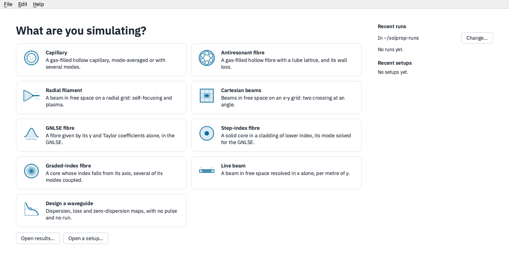

# solprop

**Ultrafast nonlinear pulse propagation in Python** — from few-cycle pulses in
gas-filled hollow-core fibres to multimode solid-core fibres and free-space beams.

:::{admonition} New: a desktop GUI (experimental)
:class: tip

Set up, run and explore simulations in a window, with no script:
`pip install "solprop[gui]"`, then `solprop-gui`. See
[the desktop GUI](#the-desktop-gui) below and its
[chapter of the user guide](guide/front-end/index.md).
:::

**Everything, fast, with rigour.** solprop aims to be one unified, highly accurate code
for nonlinear pulse propagation, scaling from a laptop to a GPU cluster, with every model
derived, cited and verified against analytic and independent references
([About solprop](introduction/about.md)).

It solves the unidirectional pulse propagation equation (UPPE) and the generalised
nonlinear Schrödinger equation (GNLSE), for the full electric field or its envelope, in
waveguides and in free space. Use it for soliton self-compression to sub-cycle pulses,
resonant dispersive-wave emission into the vacuum and deep ultraviolet, supercontinuum
generation, multimode and graded-index beam dynamics, filamentation, photoionisation and
plasma, and Raman frequency combs.

Start with the [introduction](introduction/index.md) to install solprop and work
through a simulation. The [user guide](guide/index.md) explains how to choose a
model, configure a run, and interpret its results, with the equations and numerical
details alongside the practical guidance.

The [primer](primer/index.md) is a long-form, start-to-finish account of the physics and
numerics, from Maxwell's equations through the UPPE and GNLSE to waveguides, free space,
the material responses and the numerical methods, for a day or two of reading.

The [examples](examples/index.md) explore particular physical processes and
experimental configurations. Use the [API reference](api/index.md) to look up
arguments and return values, and the [developer’s guide](dev/index.md) to work on
solprop itself.

(the-desktop-gui)=
## The desktop GUI



solprop comes with an experimental desktop front end, `solprop-gui`, for setting up,
running and reading simulations without writing Python. Pick a geometry from Home; set
it up on one sheet in physics terms, checked as you type, with the numbers solprop
computes for it, and type a target such as a soliton order to have solprop solve for
the pressure or energy that gives it; watch the spectrum and pulse grow as it runs; and
read the results at any point along the propagation, with zoom, readouts, widths at
half maximum and publication figures. Scans and a waveguide designer are built in, and
every setup saves as a recipe or a Python script, so nothing done in the window is a
dead end. Install it with `pip install "solprop[gui]"` and start it with `solprop-gui`;
[the desktop front end](guide/front-end/index.md) shows it step by step. Its interface
may still change between releases.

```{toctree}
:maxdepth: 2
:hidden:

Introduction <introduction/index>
User guide <guide/index>
Examples <examples/index>
Primer <primer/index>
Developer’s guide <dev/index>
API <api/index>
```
